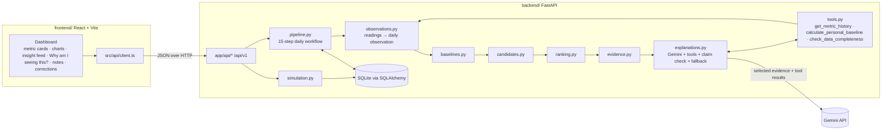

# Architecture

## Overview



The flow runs one way. Deterministic analytics rank and select up to three insights before the LLM is called. Gemini can call read-only tools to ground what it writes, and it may drop an insight it can't ground, but it can't add, reorder, or rescore anything (D13). The backend validates every explanation before keeping it.

## Backend modules (`backend/app/`)

| Module | Responsibility | I/O? |
|---|---|---|
| `config.py` | `Settings` from env: DB URL, Gemini key and model, windows, thresholds, weights, `RULE_VERSION`. | env |
| `db.py` | Engine, session, `Base`, `init_db()`. | DB |
| `models.py` | ORM tables (below). | — |
| `schemas.py` | Pydantic request/response models. | — |
| `metrics.py` | The four metric definitions: canonical unit, plausible range, conflict tolerance, direction interpretations. | — |
| `simulation.py` | Profiles A–D (goals, timezone), the 7 scenarios, seeded generator → readings and seed notes. Messy seeds for User D. | pure |
| `observations.py` | Readings → daily observation and flags (missing, unit, range, conflict, correction) (D5). | pure |
| `baselines.py` | Baseline statistics, deviation, standardized score, day-over-day and week-over-week changes, trend windows. | pure |
| `candidates.py` | Rules: deviation, trend / improving_trend, combined, data_quality; spike qualification (D16). | pure |
| `ranking.py` | Score components, weights, tie-breaks, redundancy suppression, top-N. | pure |
| `evidence.py` | Evidence records (PRD §8 fields), confidence label, fallback explanation templates. | pure |
| `tools.py` | The three LLM tools as plain functions over a user's observations (scoped and clamped). | pure |
| `explanations.py` | Gemini function-calling loop, Pydantic and numeric-claim validation, one retry, fallback. | network |
| `pipeline.py` | PRD §10 steps 1–15, plus staleness and idempotency. | DB |
| `api/data.py` | health, users, observations, simulation, notes. | HTTP |
| `api/insights.py` | baselines, generate, feed, insight, evidence, feedback, corrections. | HTTP |
| `api/errors.py` | `ApiError` and the handlers that produce the consistent error shape. | HTTP |
| `main.py` | App, CORS, consistent error handler, startup seed (users A–D if the DB is empty). | — |

## Data model (SQLite)

| Table | Key columns |
|---|---|
| `users` | `user_id` PK, `display_name`, `profile_description`, `activity_goal_steps`, `sleep_target_hours`, `timezone`, `seed`, `scenario` |
| `readings` | `id`, `user_id`, `date`, `metric`, `value` (nullable), `unit`, `is_available`, `quality_marker` (nullable), `source` (`device`/`user_correction`), `recorded_at` (UTC) |
| `notes` | `id`, `user_id`, `date`, `text`, `created_at` |
| `insight_runs` | `run_id`, `user_id`, `target_date`, `rule_version`, `generated_at`, `provider` (`gemini`/`fallback`/`mixed`/`none`), `fallback_reason`, `is_stale`, `candidates` (JSON: every candidate with score breakdown and status: selected / suppressed_redundant / below_limit / dropped_by_llm), `tool_calls` (JSON: the tools Gemini called) |
| `insights` | `insight_id`, `run_id`, `rank`, `category`, `metrics` (JSON), `direction`, `score`, `score_components` (JSON), `confidence_label`, `explanation` (JSON), `explanation_provider` |
| `evidence` | `evidence_id`, `insight_id`, all PRD §8 fields; lists stored as JSON |
| `feedback` | `id`, `insight_id`, `action` (`dismissed`/`irrelevant`), `created_at` |

Evidence is stored apart from the explanation. A combined insight has one evidence row per metric. The PRD §5 daily observation is computed from `readings` when needed (D5).

## Algorithms

### Metrics

| Metric | Unit | Reference | Dispersion | Rule threshold (default) | Minimum absolute change |
|---|---|---|---|---|---|
| `steps` | steps | median | MAD → SD fallback | ≥ 25 % vs median (median > 0) | ≥ 1000 steps |
| `sleep_hours` | hours | median | MAD → SD fallback | ≥ 1.0 h | (absolute) |
| `resting_heart_rate_bpm` | bpm | median | MAD → SD fallback | ≥ 5 bpm | (absolute) |
| `hrv_ms` | ms | median | MAD → SD fallback | ≥ 15 % vs median (median > 0) | ≥ 3 ms |

Every threshold is configurable. They're illustrative values, not medical thresholds.

### Baseline (per metric, target date `t`)

- Window: `[t − W, t − 1]`, W = 28. The target day is never included. Only non-null values count.
- If `valid_count < MIN_OBS` (14): `status = "insufficient"` with the count, no statistics, and no deviation rules run.
- Statistics: `mean`, `median`, `std` (ddof = 1), `MAD = median(|x − median|)`, latest valid value and date.
- Deviation: `absolute_difference = x − median`. `percentage_difference = 100·(x − median)/median`, only if `median > 0`.
- Standardized score: `robust_z = 0.6745·(x − median)/MAD` if `MAD ≥ MIN_MAD[metric]`; else `z = (x − mean)/std` if `std ≥ MIN_STD[metric]`; else none (`not_reliably_standardized`).
- Day-over-day: `x_t − x_{t−1}`. Week-over-week: `mean[t−6,t] − mean[t−13,t−7]`, each needing ≥ 4 valid days.
- Direction is `above` / `below` / `none`, mapped to a neutral interpretation.

### Candidate rules (`rule_id` like `deviation.sleep_hours.v1`)

1. **deviation:** `|x − median| ≥ threshold` and ≥ the minimum absolute change. Qualified as `suspicious_spike` per D16.
2. **trend / improving_trend:** the recent-window median `[t−6,t]` (≥ 4 valid days) vs. the trend baseline `[t−34,t−7]` (≥ 14 valid days) is ≥ the threshold, and ≥ 5 of the 7 recent days lie on the same side, each by ≥ half the threshold. It becomes `improving_trend` if the gap to the goal shrinks (D14).
3. **combined:** two same-day deviations forming a PRD pair: (sleep below + RHR above), (HRV below + RHR above), (steps below + sleep below). Evidence covers both metrics. Described as co-occurring, never causal.
4. **data_quality** ("missing-data warning"): one per day, listing metrics with a missing, flagged, or conflicting target value, or an insufficient baseline.

### Ranking (components in [0, 1])

| Component | Weight | Definition |
|---|---|---|
| magnitude | 0.40 | `min(|change| / threshold, 3) / 3`; combined: mean over its metrics |
| persistence | 0.20 | consecutive days ending at `t` (≤ 7) beyond the threshold on the same side, ÷ 7 |
| reliability | 0.15 | `valid_count / W` × 0.5 if not reliably standardized, spike-flagged, or target-flagged |
| relevance | 0.15 | 1.0 if the target day itself crosses the threshold, else 0.5 |
| novelty | 0.10 | 0.3 if equivalent insight surfaced in previous 3 days (D8), else 1.0 |

`score = Σ weight·component`, rounded to 4 dp. `data_quality` has a fixed score of 0.15.
**Tie-breaks**, in order: score ↓ → category priority (combined > deviation > improving_trend > trend > data_quality) → metric order (steps, sleep, RHR, HRV) → `rule_id` ↑.
**Selection:** greedy over the sorted list, skipping metric overlap (D7), up to `MAX_INSIGHTS` = 3. Zero selected is valid.

### Confidence (D9)

- `high`: coverage ≥ 0.85, no target-day flags, reliably standardized, persistence ≥ 2 days, no spike
- `low`: coverage < 0.6, a flagged or conflicting target value, a spike, or the category is `data_quality`
- `medium`: everything else

### Explanation service (D10, D13, D15)

1. Payload: selected candidates only, giving each one's insight id, category, metrics, direction, interpretation, and evidence. Plus the target-day note as `untrusted_user_note` if one exists. No user id or name.
2. Gemini call with the system prompt and the three tool declarations. Tool calls are executed in Python for the current user only (clamped dates), for at most 4 rounds. The final answer is JSON matching the `ExplanationBatch` schema, including an optional `dropped: [{insight_id, drop_reason}]`.
3. Validate: Pydantic schema → `insight_id` is known → `evidence_ids` ⊆ that insight's evidence → every number in the text is allowed (evidence ∪ tool outputs ∪ day counts and date parts; note numbers excluded).
4. On failure: one correction retry listing the errors, then the template fallback for each insight still failing. No key, an SDK error, or a timeout means fallback for all. The provider and `fallback_reason` are stored. Provider errors are never returned to clients.

## API (`/api/v1`)

| Method | Path | Notes |
|---|---|---|
| GET | `/health` | status, db, `llm_mode` |
| GET | `/users` | users with goals, timezone, `today`, scenario |
| GET | `/users/{user_id}/observations?start=&end=` | daily observations (PRD §5 shape) plus flags |
| POST | `/simulation/generate` | `{user_id, scenario, seed?, days?, end_date?}` |
| GET | `/simulation/scenarios` | scenario catalog |
| GET | `/users/{user_id}/baselines?date=` | per metric: today's value, baseline statistics, deviation, day-over-day, week-over-week, status |
| POST | `/users/{user_id}/insights/generate` | `{date, force?}` (idempotent, D11) |
| GET | `/users/{user_id}/insights?date=` | feed: latest non-stale run, visible insights, `hidden_count`, provider (404 `insights_outdated` if the day's runs went stale, D30; else 404 `insights_not_generated`) |
| GET | `/insights/{insight_id}` | insight plus explanation |
| GET | `/insights/{insight_id}/evidence` | evidence records |
| POST | `/insights/{insight_id}/feedback` | `{action}` (D17) |
| GET / POST | `/users/{user_id}/notes` | list (`?date=`) / add a note (D15) |
| POST | `/users/{user_id}/corrections` | `{date, metric, value}` → stale + regenerate (D18) |
| POST | `/users/{user_id}/corrections/batch` | `{corrections: [...]}` 1–112, all or nothing → stale, **no** regeneration (D29) |

Errors look like `{"error": {"code": "...", "message": "..."}}` with 400/404/422/500. No stack traces, secrets, or provider messages.

## Frontend (`frontend/src/`)

```
api/        client.ts (typed fetch wrapper), types.ts (mirrors backend schemas)
hooks/      useAsync.ts
format.ts   display formatting only (units, separators, flag text); never statistics
components/ Header (logo, disclaimer), Controls (user · date · scenario + tab bar), MetricCard (goal ring,
            highlight, + correct value), TrendChart (glowing animated line, metric switch, 7/28 d, baseline
            line), DataEditor (28-day table, batch save), InsightFeed (+ outdated state), InsightCard
            (headline, explanation, confidence, dismiss/irrelevant, "Why am I seeing this?" → EvidencePanel),
            NotesPanel, DataQualityStatus, ProviderBadge, StateViews (loading/empty/error/insufficient)
App.tsx     page composition: selected user/date, Dashboard / Edit data tabs, unsaved edits
test/       Vitest setup and fixtures
```

`frontend/e2e/` holds the Playwright tests. `playwright.config.ts` starts the real backend in fallback mode (temp DB, port 8001) and Vite (port 5174).

Every number on screen comes from an API response, including goal-ring progress (D31). The frontend never computes statistics. Theme tokens live in `index.css` (`@theme`). Every animation is disabled under `prefers-reduced-motion`.
