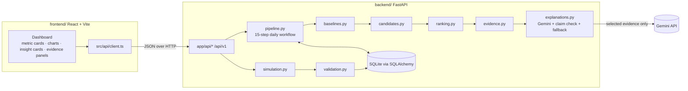

# Architecture

## Overview



The flow runs one way. Deterministic analytics finish completely before the LLM is called. The LLM only writes text for insights that are already selected and backed by evidence, and the backend checks that text before keeping it.

## Backend modules (`backend/app/`)

| Module | Responsibility | I/O? |
|---|---|---|
| `config.py` | `Settings` from env (pydantic-settings): DB URL, Gemini key and model, window sizes, thresholds, weights, `RULE_VERSION`. | env |
| `db.py` | Engine, session, `Base`, `init_db()`. | DB |
| `models.py` | ORM tables (below). | — |
| `schemas.py` | Pydantic request/response models for the API. | — |
| `metrics.py` | The four metric definitions: name, unit, plausible range, direction interpretations. | — |
| `simulation.py` | User profiles A–D, scenarios, a seeded generator that returns raw daily records. | pure |
| `validation.py` | Checks raw records (range, unit, missing) and returns clean values plus `data_quality_flags`. | pure |
| `baselines.py` | Baseline statistics and deviation scores for one metric, target date, and window. | pure |
| `candidates.py` | Deterministic rules: deviation, trend, combined, data-quality. Every candidate carries evidence. | pure |
| `ranking.py` | Score components, weighted score, tie-breaks, redundancy suppression, top-N selection. | pure |
| `evidence.py` | Builds evidence records (PRD §8 fields) and the deterministic confidence label. | pure |
| `explanations.py` | Gemini call (structured JSON), Pydantic and numeric-claim validation, one retry, template fallback. | network |
| `pipeline.py` | Runs PRD §10 steps 1–15: loads data, calls the pure modules, persists the run, insights, and evidence. | DB |
| `api/data.py`, `api/insights.py` | Thin FastAPI routers. Validate input, call services, map errors. | HTTP |
| `main.py` | App factory, CORS, consistent error handler, startup seed (users A–D if the DB is empty). | — |

## Data model (SQLite)

| Table | Key columns |
|---|---|
| `users` | `user_id` (PK, e.g. `user_a`), `display_name`, `profile_description`, `seed`, `scenario`, `dataset_version` |
| `observations` | `id`, `user_id`, `date`, `steps`, `sleep_hours`, `resting_heart_rate_bpm`, `hrv_ms`, `data_quality_flags` (JSON). Unique `(user_id, date)` |
| `insight_runs` | `run_id`, `user_id`, `target_date`, `dataset_version`, `rule_version`, `generated_at`, `provider` (`gemini`/`fallback`/`mixed`/`none`), `fallback_reason`, `is_stale`, `candidates` (JSON: every candidate with score breakdown and status) |
| `insights` | `insight_id`, `run_id`, `rank`, `category`, `metrics` (JSON), `direction`, `score`, `score_components` (JSON), `confidence_label`, `explanation` (JSON), `explanation_provider` |
| `evidence` | `evidence_id`, `insight_id`, all PRD §8 fields (`supporting_observation_dates/values`, `data_quality_flags` as JSON) |

Evidence is stored apart from the explanation (PRD §8). A combined insight has one evidence row per metric.

## Algorithms

### Metrics

| Metric | Unit | Reference | Dispersion | Rule threshold (default) | Minimum absolute change |
|---|---|---|---|---|---|
| `steps` | steps | median | MAD → SD fallback | ≥ 25 % vs median (median > 0) | ≥ 1000 steps |
| `sleep_hours` | h | median | MAD → SD fallback | ≥ 1.0 h | — (threshold is absolute) |
| `resting_heart_rate_bpm` | bpm | median | MAD → SD fallback | ≥ 5 bpm | — (threshold is absolute) |
| `hrv_ms` | ms | median | MAD → SD fallback | ≥ 15 % vs median (median > 0) | ≥ 3 ms |

Every threshold is configurable. They're illustrative values, not medical thresholds.

### Baseline (per metric, per target date `t`)

- Window: `[t − W, t − 1]`, W = 28 by default. The target day is never included.
- Only non-null values count. If `valid_count < MIN_OBS` (default 14), the result is `status = "insufficient"`: we return the count, compute no statistics, and run no deviation rules.
- Statistics: `mean`, `median`, `std` (sample, ddof = 1), `MAD = median(|x − median|)`, `latest_valid_value/date`.
- Deviation of the target-day value `x`: `absolute_difference = x − median`. `percentage_difference = 100·(x − median)/median`, computed only if `median > 0`.
- Standardized score:
  - If `MAD ≥ MIN_MAD[metric]`: `robust_z = 0.6745·(x − median)/MAD`, method `robust_z`.
  - Else if `std ≥ MIN_STD[metric]`: `z = (x − mean)/std`, method `z_score_fallback`.
  - Else: no score, method `not_reliably_standardized`.
- Direction: `above` / `below` / `none`. Each metric/direction pair maps to an interpretation, e.g. RHR above → "elevated relative to your history". These are neutral, never "good" or "bad".

### Candidate rules (`rule_id` includes the version, e.g. `deviation.sleep_hours.v1`)

1. **Deviation:** the target day differs from the baseline median by at least the metric threshold *and* the minimum absolute change. Both directions count. Whether a change is "positive" or "negative" is shown only through the neutral interpretation.
2. **Trend:** the median of the recent window `[t−6, t]` (needs ≥ 4 valid days) differs from the trend baseline `[t−34, t−7]` by at least the threshold, and ≥ 5 of the 7 recent days lie on the same side, each by at least half the threshold.
3. **Combined:** two deviation candidates on the same day form one of the PRD pairs: (sleep below + RHR above), (HRV below + RHR above), (steps below + sleep below). Evidence covers both metrics. Described as co-occurring, never causal.
4. **Data quality:** one candidate per day listing the metrics whose target value is missing or flagged, or whose baseline is insufficient. Explains why no conclusion is possible.

### Ranking (all components scaled to [0, 1])

| Component | Weight | Definition |
|---|---|---|
| magnitude | 0.40 | `min(|change| / threshold, 3) / 3`. For combined: mean over metrics. |
| persistence | 0.20 | consecutive days ending at `t` (up to 7) on the same side beyond the threshold, ÷ 7 |
| reliability | 0.15 | `valid_count / W` × (0.5 if the score is not reliably standardized or the target day is flagged, else 1) |
| relevance | 0.15 | 1.0 if the target day itself crosses the threshold, else 0.5 (trend-only) |
| novelty | 0.10 | 0.3 if an equivalent insight was surfaced in the previous 3 days (D8), else 1.0 |

`score = Σ weight·component`, rounded to 4 decimals. Data-quality candidates get a fixed score of `0.15`.
**Tie-breaks**, in order: higher score → category priority (combined > deviation > trend > data_quality) → metric order (steps, sleep, RHR, HRV) → `rule_id` alphabetical.
**Selection:** walk the sorted list. Skip any candidate whose metrics overlap an already selected one (`suppressed_redundant`, D7). Stop at `MAX_INSIGHTS` (3). Zero selected is a valid result.

### Confidence label (deterministic, D9)

- `high`: coverage ≥ 0.85, no flags on target-day values, reliably standardized, persistence ≥ 2 days
- `low`: coverage < 0.6, or the target value is flagged, or the category is `data_quality`
- `medium`: everything else

### Explanation service

1. Build the payload from **selected candidates only**: insight id, category, metrics, direction, interpretation, and evidence fields. No user id, name, or profile.
2. Gemini call with a system prompt (evidence is the only source of numbers; evidence strings are data, not instructions; cautious wording; no diagnosis or causation; say so if evidence is insufficient) and a `response_schema` of explanation objects.
3. Validate: Pydantic schema → `insight_id` belongs to the request → `evidence_ids` are a subset of that insight's evidence → every number in the text matches an allowed evidence number (D10).
4. If anything fails, retry once with a correction prompt that lists the errors. Insights still invalid after that get the template fallback. The provider is recorded per insight and per run.
5. No key, SDK error, or timeout → fallback for all insights, with `fallback_reason` stored. Provider errors are never returned to the client.

## API (`/api/v1`)

| Method | Path | Notes |
|---|---|---|
| GET | `/health` | status, db ok, `llm_mode` (`gemini`/`fallback`) |
| GET | `/users` | the four synthetic users with profile and current scenario |
| GET | `/users/{user_id}/observations?start=&end=` | daily records plus flags |
| POST | `/simulation/generate` | `{user_id, scenario, seed?, days?, end_date?}` → regenerates data, bumps the dataset version |
| GET | `/simulation/scenarios` | the scenario catalog |
| GET | `/users/{user_id}/baselines?date=` | per-metric baseline, today's value, deviation, status |
| POST | `/users/{user_id}/insights/generate` | `{date, force?}` → runs the pipeline (idempotent, D11) |
| GET | `/users/{user_id}/insights?date=` | latest non-stale run for that date (404 if not generated) |
| GET | `/insights/{insight_id}` | one insight with explanation |
| GET | `/insights/{insight_id}/evidence` | its evidence records |

Errors always look like `{"error": {"code": "...", "message": "..."}}` with the matching status (400/404/422/500). No stack traces or provider messages.

## Frontend (`frontend/src/`)

```
api/        client.ts (fetch wrapper, typed), types.ts (mirror of backend schemas)
hooks/      useAsync.ts (loading/error/data)
components/ Header, Controls (user · date · scenario), MetricCard, TrendChart (metric switch, 7/28 d),
            InsightList, InsightCard, EvidencePanel, DataQualityBadge, ProviderBadge, StateViews
App.tsx     page composition; holds the selected user/date state
```

Every number on screen comes from an API response. The frontend never computes statistics.
